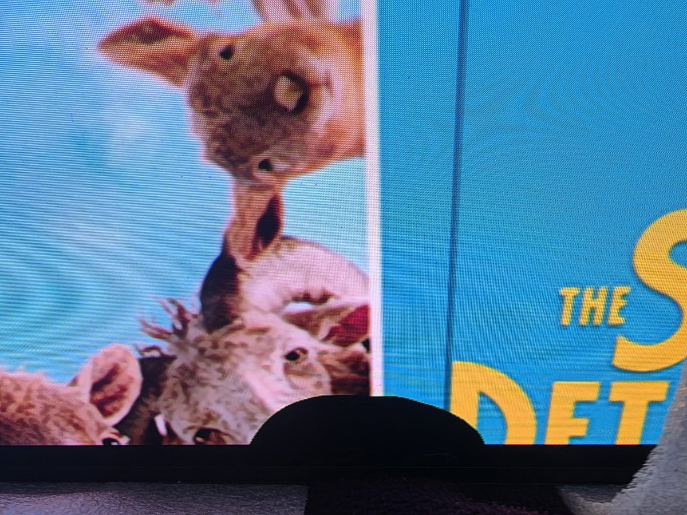
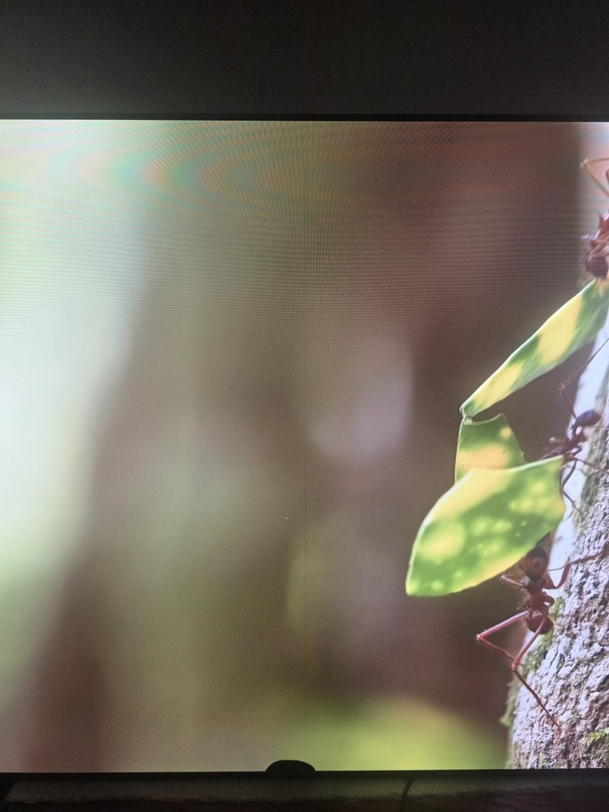
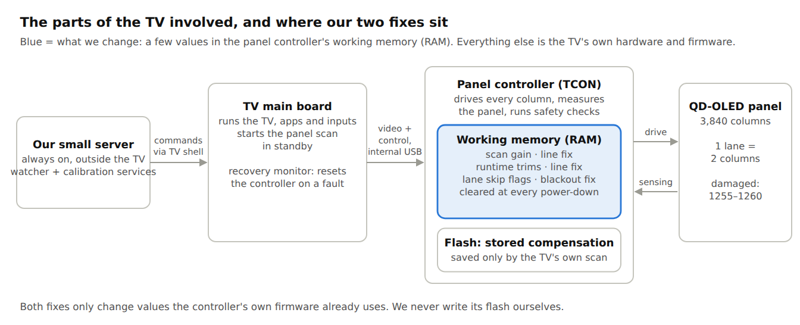
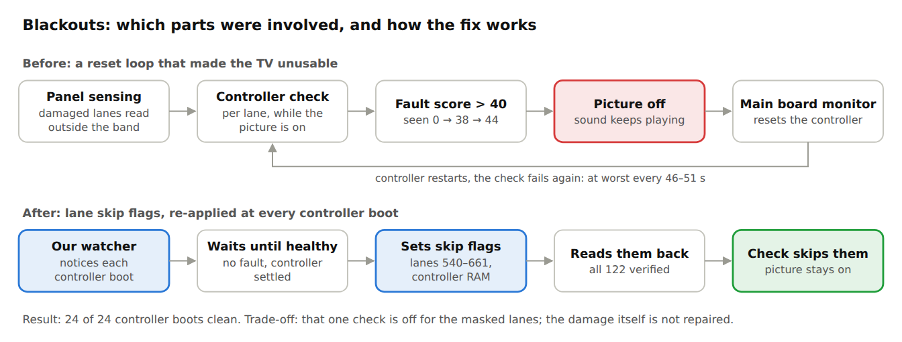
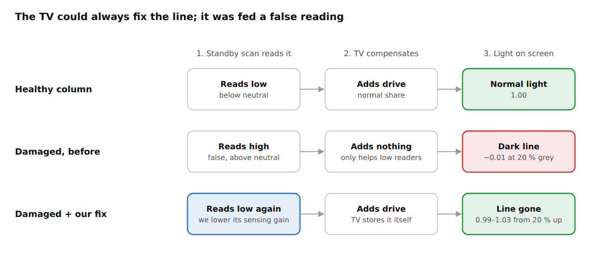
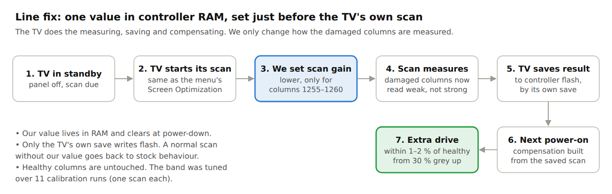
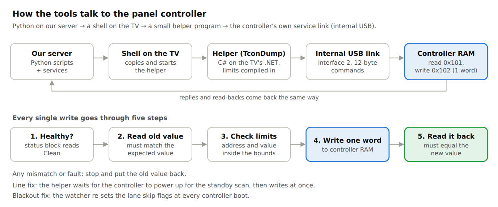
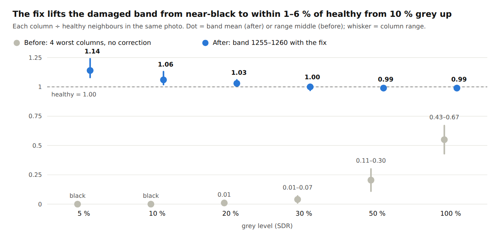

# Fixing a dead-column line and recurring panel blackouts on a damaged OLED TV

Impact damage at the bottom edge of this 77-inch QD-OLED (a Samsung S95F) caused two faults. **The first made the TV
unusable:** on dark or sparse screens the picture kept switching off while the sound played on, and at its worst it
happened about every 50 seconds. The cause was a safety check inside the **panel controller (TCON)**, the chip between
the TV's main board and the panel. The damaged lanes kept reading outside their expected range, so a fault score passed
its limit and the controller stopped the picture. The TV then reset the controller, and the check failed again. We fixed
it by setting the controller's own per-lane **"skip" flag** for the damaged lanes in its working memory (RAM). A small
service on a home server re-applies the flags at every controller boot and reads them back. All 24 controller boots
checked since have stayed clean.

**The second fault was a dark vertical line:** six columns were damaged, and the four worst gave about 1 % of normal
light at 20 % grey. The TV already
measures every column in standby and adds drive to weak ones, but the damaged columns gave a false "strong" reading, so
they got nothing. Just before the TV's own scan, we lower the **measuring gain** for those columns in controller RAM. The
scan then sees them as weak, and the TV compensates them and saves that itself. After eleven calibration runs (one TV scan each), the
band is within **1–2 % of its neighbours from 30 % grey up**. Very dark greys are still slightly yellow. We never write
the controller's flash ourselves, and the physical damage remains.

**Prerequisite for both TV-side fixes.** You need an existing root shell on your own TV. [Verify TV root access and read the research notes](https://github.com/TheMHD1/samsung-s95f-root-access).

**Blackouts:** [short explanation ↓](#problem-1-the-blackouts-in-short) · [deep dive](docs/advanced/BLACKOUT-MITIGATION.md) ·
**Line:** [short explanation ↓](#problem-2-the-dark-line-in-short) · [deep dive](docs/advanced/tv-calibration/WRITEUP.md) ·
[Results](#results) · [How the tools work](#how-the-tools-work) · [Do it yourself](tools/tcon-calibration/GUIDE.md) · [Safety](SAFETY.md)

| Before | After the fix |
| :---: | :---: |
|  |  |

## The TV, in one picture

The **main board** runs the TV and decides when the panel gets its maintenance scan. The **panel controller (TCON)**
drives every column, measures the panel and runs its safety checks. Its **RAM** holds the working values both our fixes
change. Its **flash** holds the stored compensation, which only the TV's own scan writes. **Our server** sits outside
the TV and re-applies our values whenever the controller restarts, because RAM clears at every power-down.

## Problem 1: the blackouts, in short

Between the TV's main board and the panel sits a separate **panel controller (TCON)**. While the TV is on, it keeps
checking the panel. These parts were involved:

| Part | What it does | What happened / what we changed |
| --- | --- | --- |
| **Per-lane sensing check** (*RT Protect*) | Compares each lane's sensing reading with a reference band. A lane covers about two panel columns | All 24 lanes seen failing were inside the damaged area (about lanes 554–649) |
| **Fault score** | Lanes that keep failing raise a score. Above 40 the controller stops the picture (status `0x10`) | It went 0 → 38 → 44: picture off, sound still playing |
| **TV's recovery monitor** | Watches the controller's fault line and resets the controller, which reconnects over its internal USB link | The check failed again straight away: at worst a reset loop every 46–51 s |
| **Lane skip flag** (our fix) | The controller's own lane table has a "skip" bit per lane. Skipped lanes are left out of the check | We set it for lanes 540–661 (122 entries) in controller RAM. In testing, the picture stayed on |
| **Mask watcher** (our service) | Controller RAM clears at every controller power-up, and stock code can rewrite the table | A small server service spots each controller boot, waits for a clean state, writes the flags and reads them back |

**Result:** 24 of 24 controller boots masked cleanly, and the screens that used to black out stay on.
**Trade-off:** the mask switches off that one sensing-consistency check for the masked lanes, so the panel's protection is
not fully unchanged. Current monitoring and panel power control were not touched. It does not repair the damage, and it
does not prove that driving the damaged area long-term is safe.
**[Deep dive: fault evidence, exact bits, watcher states, recovery and limits →](docs/advanced/BLACKOUT-MITIGATION.md)** ·
**[The watcher script and helpers →](tools/tcon-calibration/services/lane-mask-watcher/README.md)**

## Problem 2: the dark line, in short

OLED pixels age unevenly, so in standby the TV measures every column and boosts weak ones. The damaged columns gave a
false "strong" reading and got no boost. **Our fix** lowers the measurement's gain on those columns just for the scan;
the TV then boosts them and saves that itself. Two small runtime trims fine-tune the band after each power-on.
**[Deep dive: measurement, the eleven calibration runs, what failed and why →](docs/advanced/tv-calibration/WRITEUP.md)**

## How the tools work

Everything runs from a small server. Python scripts reach the TV through a shell on the TV, copy a small C# helper
program onto it, and the helper talks to the panel controller over the controller's own **internal USB service link**
(simple read and write commands). Every write is checked five ways and read back; anything unexpected puts the old value
back. Services re-apply both fixes after every controller boot. Scripts: the [blackout watcher](tools/tcon-calibration/services/lane-mask-watcher/README.md)
and the [line-fix kit](tools/tcon-calibration/).
**[How the tools work, step by step →](docs/advanced/tv-calibration/HOW-THE-TOOLS-WORK.md)**

## How the two fixes fit together

Both fixes are small writes to the panel controller's RAM that steer its own stock loops. Nothing is written to its
flash by us; the TV's own scan and save keep the line compensation.

## Results

| | Before | After |
| --- | --- | --- |
| **Blackouts** | Picture off and controller reset about every 50 s on the worst days; TV unusable | 24 of 24 controller boots clean; no blackouts |
| **Line at 20 % grey** (worst columns) | ~1 % of normal light | +3 % (band mean; columns +1 to +6 %) |
| **Line from 30 % to 100 % grey** | 1–67 % of normal light; black below 20 % | Within 1–2 % of healthy neighbours |

- **Still there:** blue is short below ~30 % grey, so the band looks **slightly yellow in very dark scenes**
  ([why](docs/advanced/tv-calibration/WRITEUP.md#8-what-failed-and-why)). Near black the band is +6 % at 10 % grey.

More photos: [gallery in the write-up](docs/advanced/tv-calibration/WRITEUP.md#13-photos-and-tools) · all numbers:
[RESULTS.md](docs/advanced/tv-calibration/RESULTS.md)

## Do it on your own TV

The [guide](tools/tcon-calibration/GUIDE.md) walks through measuring the line with a camera, checking that your
damage reads the same way, the first calibration run, tuning per column, the runtime trims, automation and recovery, with the
[scripts](tools/tcon-calibration/). You need a **root shell on your own TV**, the TV's internal
controller link, a camera on a tripod and a media player for test patterns. The blackout fix has its own script and setup notes:
[lane-mask watcher](tools/tcon-calibration/services/lane-mask-watcher/README.md). Writing to a panel controller can damage
a TV: read the [safety rules](SAFETY.md) first.

**Other TVs?** The idea may carry over to other OLED and QD-OLED TVs whose damaged columns read wrong in their own
sensing scan; our addresses and values do not. Nothing was tried on another TV.
[What carries over →](docs/advanced/tv-calibration/WRITEUP.md#12-will-this-work-on-other-oled-and-qd-oled-tvs)

## Everything we tried on this TV

| Approach | How it works | Status |
| --- | --- | --- |
| **Scan-time calibration** | Sensing gain in controller RAM before the TV's own scan; runtime trims after each boot | **In use** · [write-up](docs/advanced/tv-calibration/WRITEUP.md) |
| **Blackout lane mask** | Skip flags for lanes 540–661 in the sensing check, re-applied by a watcher | **In use** · [details](docs/advanced/BLACKOUT-MITIGATION.md) |
| Native-4K Kodi correction | Per-column strip in the player's GUI and HDR shader | Retired on this TV; works on any display for Kodi content · [guide](docs/kodi/README.md) |
| TV graphics overlay | EFL overlay plus paired MGA gain | Retired |

These fixes act on the image and on the fault behavior; the physical damage remains.

## Guides — pick your goal

| I want to… | Guide |
| --- | --- |
| **Fix the line inside the TV** | [Guide, scripts, safety and recovery](tools/tcon-calibration/GUIDE.md) · [the story](docs/advanced/tv-calibration/WRITEUP.md) |
| **Install the sharper Kodi SDR/HDR line fix** | [Complete installation, Arctic integration, profiles and removal](docs/kodi/README.md) |
| **Calibrate my own damaged columns** | [RAW-camera setup, reference shots, SDR/chroma/HDR fitting](docs/kodi/CALIBRATION.md) |
| **Understand the panel blackout/crash bypass** | [Fault evidence, exact skip bits, watcher, recovery and limits](docs/advanced/BLACKOUT-MITIGATION.md) |
| **Investigate Mobile Demura / future panel flashing** | [App, protocols, firmware, backup failures and remaining gaps](docs/advanced/panel/README.md) |
| **Build on the reverse engineering** | [Technical handbook and evidence index](docs/advanced/README.md) |

[**Player implementation**](code/README.md) · [**Photo provenance**](docs/PHOTO-GALLERY.md) · [**Safety and rollback**](SAFETY.md)

The blackout mask reduces diagnostic coverage; compensation RAM can reach persistent storage through stock firmware. No panel-calibration flash or qualified native-calibration restore was attempted. This package keeps private device identities, credentials, OEM binaries/keys and unique calibration dumps outside Git.

MIT ([LICENSE](LICENSE)), except the Kodi-derived shaders, which remain GPL-2.0-or-later. Independent owner-device research; not affiliated with Samsung, Kodi or CoreELEC.
