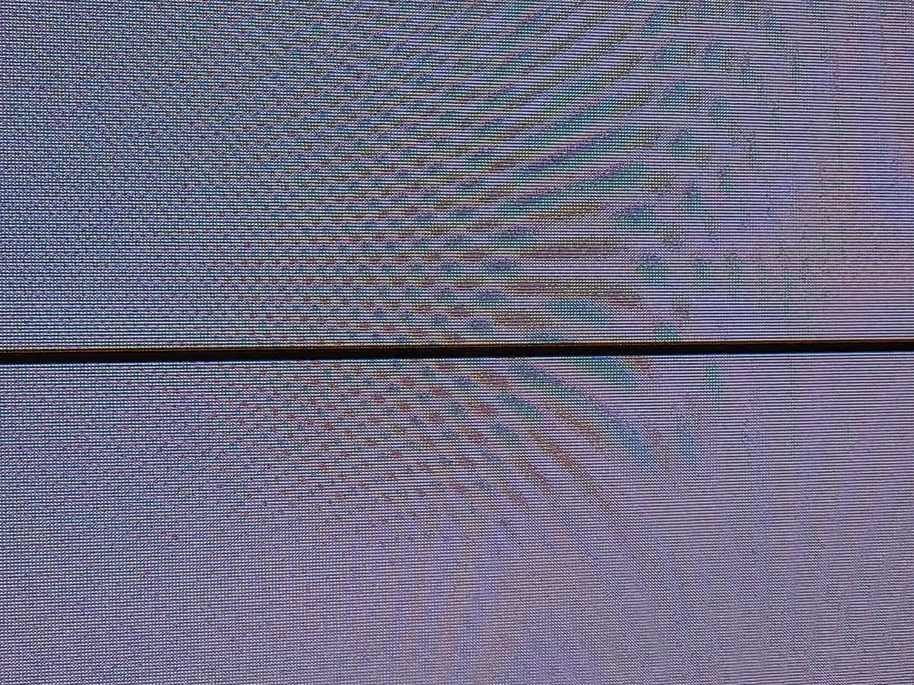
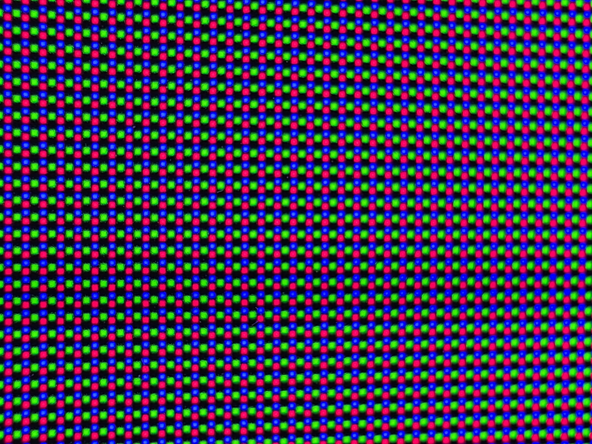

# Samsung S95F Display Lab

**Rooted TV research · blackout mitigation · visible-line correction · SDR/HDR calibration**

We obtained **root access to a Samsung S95F TV (UID/EUID 0)** and used it to work with kernel driver interfaces, display registers, controller memory and the graphics compositor. On a physically damaged **77-inch QD-OLED**, that enabled a working blackout mitigation and TV-side line correction. We then built a sharper **native-4K Kodi correction** on a **Ugoos AM9 Pro / CoreELEC / Arctic Fuse 3**.

**[Start here](docs/START-HERE.md)** · [Root access](docs/advanced/ROOT-ACCESS.md) · [TV graphics fix](docs/advanced/TV-LINE-CORRECTION.md) · [Kodi install](docs/kodi/README.md) · [Blackout fix](docs/advanced/BLACKOUT-MITIGATION.md) · [Panel research](docs/advanced/panel/README.md)

## What we fixed

The damaged columns **1255–1260** were too dim, particularly in dark scenes; the panel also repeatedly went black while audio continued. These needed separate solutions.

| Working result | How it works | Coverage |
| --- | --- | --- |
| **Stop the recurring panel blackouts** | Guarded controller-RAM writes set skip flags for lanes 540–661. A server watcher verifies the mask and handles bounded recovery after controller resets. | Owner-confirmed on the damaged S95F; suppresses that part of a sensing-consistency check |
| **Reduce the visible line inside the TV** | An EFL graphics overlay dims the surrounding picture; paired MGA RGB gain restores the background while the damaged strip receives a relative lift. | Camera-measured on the tested TV path; 1080p graphics scaling spreads correction into neighbours |
| **Correct the line more precisely through Kodi** | A native-4K strip adjusts individual columns and colours. The patched HDR shader applies the correction in raw PQ. | Tested SDR/HDR10/HDR10+ Kodi path; avoids the TV overlay's 2× scaling blur |

These techniques compensate the **image and fault behavior**; the physical panel damage remains.

## The line, photographed

| Phone reference — dark grey | Phone close-up — individual subpixels |
| :---: | :---: |
|  |  |
| SDR grey 10; the dark line is prominent. | SDR grey 50; the RGB grid shows the affected columns. |

These are **original defect/reference photos**, not a matched before/after pair. The later **Sony a7 IV** sessions supplied the calibrated measurements below. We recovered a Sony setup preview, but no confirmed final after-photo or distant after-shot. [Photo gallery, sources and capture limits →](docs/PHOTO-GALLERY.md)

## How well does the line correction work?

At a **2-nit HDR target**, the original line measured about **0.02×** its healthy neighbours. Correction brought it close to their brightness. Near black and bright highlights remain harder to match.

| HDR target | Final Kodi HDR v2 ratio to healthy neighbours | Practical result |
| --- | --- | --- |
| **0.5 nits — near black** | **0.53–0.86×** | Still visibly dimmer; incomplete correction |
| **2 nits — dark detail** | **1.01–1.18×** | Close match, with some overcorrection |
| **5 nits** | **1.06–1.26×** | Some columns remain too bright |
| **15 nits** | **0.95–1.08×** | Closest measured match in this final profile |
| **100 nits — brighter test** | **0.81–0.92×** | A residual dim line remains |
| **Brighter highlights (>100 nits)** | No final measured range published | The affine fit can under-correct above ~300 nits; full-field ABL also affects output |

**SDR:** measured ratios were **0.96–1.19× at grey 13** and **0.98–1.09× at grey 51**, using paired dimming/TV gain. The default B=0 Kodi SDR variant was not separately camera-verified. SDR code levels are not nit values. **1.00× means equal measured luminance**, not guaranteed invisibility. [Full results](docs/kodi/RESULTS-AND-LIMITS.md) · [Measurement chart](docs/assets/hdr-result-ranges.png)

## Root, kernel, memory and graphics access

| Demonstrated access | What we used it for |
| --- | --- |
| **Root session on the TV** | SDK archive-root with an S95F runtime-discovery patch; authenticated host-assisted reacquisition |
| **Kernel/display-driver interfaces** | Reviewed `/dev/tztv_tcon` ioctls, FRC debugfs register access and display-state investigation |
| **External controller RAM** | USB read/write transport, sensing-table analysis and the bounded blackout mask |
| **TV graphics/display controls** | EFL/Wayland surfaces, HWC/compositor control, MGA RGB gain and Pixel Shift following |
| **Firmware and calibration-storage analysis** | Save/load paths, exact storage descriptors, Mobile Demura flash chain and false-success/rollback findings |

Root did not remove every SMACK restriction. The working TV correction uses **graphics composition and display gain**; direct GPU-memory video injection and unrestricted kernel-memory control were not demonstrated. Native panel-calibration flashing remains research.

## Guides — pick your goal

| I want to… | Guide |
| --- | --- |
| **Obtain compatible root access** | [Prerequisites, S95F patch, commands and session lifecycle](docs/advanced/ROOT-ACCESS.md) |
| **Understand/reproduce the TV graphics line fix** | [Root → overlay → paired gain → calibration → cleanup](docs/advanced/TV-LINE-CORRECTION.md) |
| **Install the sharper Kodi SDR/HDR line fix** | [Complete installation, Arctic integration, profiles and removal](docs/kodi/README.md) |
| **Calibrate my own damaged columns** | [RAW-camera setup, reference shots, SDR/chroma/HDR fitting](docs/kodi/CALIBRATION.md) |
| **Understand the panel blackout/crash bypass** | [Fault evidence, exact skip bits, watcher, recovery and limits](docs/advanced/BLACKOUT-MITIGATION.md) |
| **Investigate Mobile Demura / future panel flashing** | [App, protocols, firmware, backup failures and remaining gaps](docs/advanced/panel/README.md) |
| **Build on the reverse engineering** | [Technical handbook and evidence index](docs/advanced/README.md) |

[**Player implementation**](code/README.md) · [**TV overlay / root patch / offline tools**](research/README.md) · [**Photo provenance**](docs/PHOTO-GALLERY.md) · [**Safety and rollback**](SAFETY.md)

The blackout mask reduces diagnostic coverage; compensation RAM can reach persistent storage through stock firmware. No panel-calibration flash or qualified native-calibration restore was attempted. This package keeps private device identities, credentials, OEM binaries/keys and unique calibration dumps outside Git.

MIT ([LICENSE](LICENSE)), except the Kodi-derived shaders, which remain GPL-2.0-or-later. Independent owner-device research; not affiliated with Samsung, Kodi or CoreELEC.
