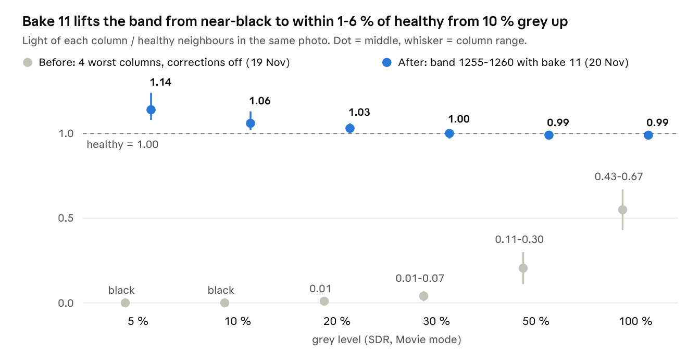
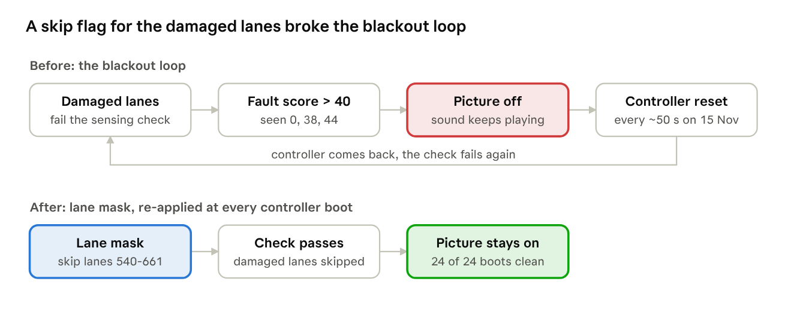
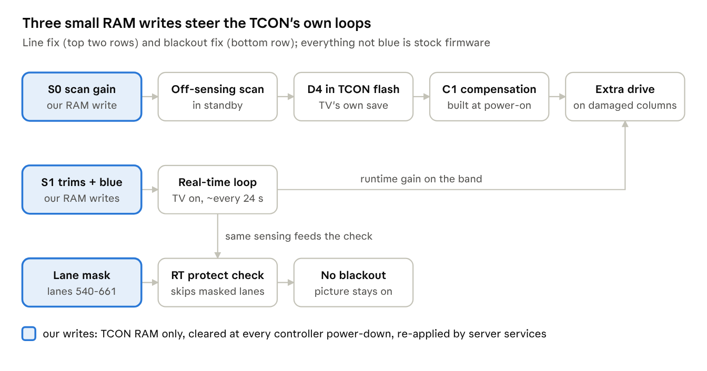

# Samsung S95F Display Lab

**A damaged 77-inch QD-OLED, fixed from inside the TV · blackout mitigation · line calibration · SDR/HDR research**

> **The dark line is fixed inside the TV, for every input and app.** We let the TV's own
> panel scan measure the damaged columns correctly, so its own compensation drives them again. No flash write.
> **[Read the story →](docs/advanced/tv-calibration/WRITEUP.md)** · [Results](docs/advanced/tv-calibration/RESULTS.md) ·
> [Do it yourself](tools/tcon-calibration/GUIDE.md) · [Blackout fix](docs/advanced/BLACKOUT-MITIGATION.md)

## Results

| Before | After bake 11 |
| :---: | :---: |
|  |  |

- **Before:** the four worst columns gave **~1 % of normal light at 20 % grey** and were black below that.
- **After:** the band is within **1–2 % of its neighbours from 30 % to 100 % grey**, +3 % at 20 %, +6 % at 10 %.
- **Still there:** blue is short below ~30 % grey, so the band looks **slightly yellow in very dark scenes**
  ([why](docs/advanced/tv-calibration/WRITEUP.md#8-what-failed-and-why)).
- **Blackouts:** the panel used to switch itself off every ~50 s on bad days; with the lane mask, **24 of 24 controller
  boots** stayed clean.

More photos: [gallery in the write-up](docs/advanced/tv-calibration/WRITEUP.md#13-photos-and-tools) · all numbers:
[RESULTS.md](docs/advanced/tv-calibration/RESULTS.md)

## How it works, in two pictures

OLED pixels age unevenly, so in standby the TV measures every column and boosts weak ones. The damaged columns gave a
false "strong" reading and got no boost. **Bake 11** lowers the measurement's gain on those columns just for the scan;
the TV then boosts them and saves that itself. [Deep dive →](docs/advanced/tv-calibration/WRITEUP.md#3-why-the-tvs-own-compensation-did-not-help)

The panel controller kept failing a per-lane sensing check on the damaged lanes, switched the picture off and was
reset, over and over. A **skip flag for lanes 540–661** in controller RAM, re-applied at every controller boot, ended it.
[Deep dive →](docs/advanced/BLACKOUT-MITIGATION.md)

## Do it on your own TV

The [guide](tools/tcon-calibration/GUIDE.md) walks through measuring the line with a camera, checking that your
damage reads the same way, the first bake, tuning per column, the runtime trims, automation and recovery, with the
[scripts](tools/tcon-calibration/). You need a **root shell on your own TV** (not covered by the guide), the TV's internal
controller link, a camera on a tripod and a media player for test patterns. Writing to a panel controller can damage
a TV: read the [safety rules](SAFETY.md) first.

**Other TVs?** The idea may carry over to other OLED and QD-OLED TVs whose damaged columns read wrong in their own
sensing scan; our addresses and values do not. Nothing was tried on another TV.
[What carries over →](docs/advanced/tv-calibration/WRITEUP.md#12-will-this-work-on-other-oled-and-qd-oled-tvs)

## Everything we tried on this TV

| Approach | How it works | Status |
| --- | --- | --- |
| **Scan-time calibration (bake 11)** | Sensing gain in controller RAM before the TV's own scan; runtime trims after each boot | **In use** · [write-up](docs/advanced/tv-calibration/WRITEUP.md) |
| **Blackout lane mask** | Skip flags for lanes 540–661 in the sensing check, re-applied by a watcher | **In use** · [details](docs/advanced/BLACKOUT-MITIGATION.md) |
| Native-4K Kodi correction | Per-column strip in the player's GUI and HDR shader | Retired on this TV; works on any display for Kodi content · [guide](docs/kodi/README.md) |
| TV graphics overlay | EFL overlay plus paired MGA gain | Retired |

These fixes act on the image and on the fault behavior; the physical damage remains.

## Guides — pick your goal

| I want to… | Guide |
| --- | --- |
| **Fix the line inside the TV (bake 11)** | [Guide, scripts, safety and recovery](tools/tcon-calibration/GUIDE.md) · [the story](docs/advanced/tv-calibration/WRITEUP.md) |
| **Install the sharper Kodi SDR/HDR line fix** | [Complete installation, Arctic integration, profiles and removal](docs/kodi/README.md) |
| **Calibrate my own damaged columns** | [RAW-camera setup, reference shots, SDR/chroma/HDR fitting](docs/kodi/CALIBRATION.md) |
| **Understand the panel blackout/crash bypass** | [Fault evidence, exact skip bits, watcher, recovery and limits](docs/advanced/BLACKOUT-MITIGATION.md) |
| **Investigate Mobile Demura / future panel flashing** | [App, protocols, firmware, backup failures and remaining gaps](docs/advanced/panel/README.md) |
| **Build on the reverse engineering** | [Technical handbook and evidence index](docs/advanced/README.md) |

[**Player implementation**](code/README.md) · [**Photo provenance**](docs/PHOTO-GALLERY.md) · [**Safety and rollback**](SAFETY.md)

The blackout mask reduces diagnostic coverage; compensation RAM can reach persistent storage through stock firmware. No panel-calibration flash or qualified native-calibration restore was attempted. This package keeps private device identities, credentials, OEM binaries/keys and unique calibration dumps outside Git.

MIT ([LICENSE](LICENSE)), except the Kodi-derived shaders, which remain GPL-2.0-or-later. Independent owner-device research; not affiliated with Samsung, Kodi or CoreELEC.
