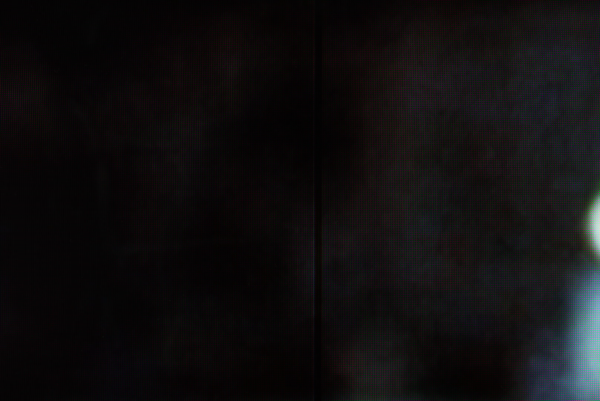
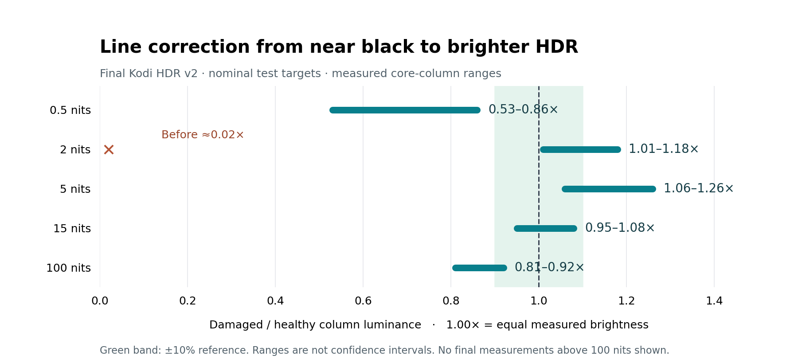

# Photos and measured results

[Project](../README.md) · [Calibration](kodi/CALIBRATION.md) · [Results](kodi/RESULTS-AND-LIMITS.md)

The original project used phone photographs for visual inspection and later a **Sony a7 IV** for calibrated close-up measurements. The surviving phone files below are Galaxy S25 Ultra images, including an early pixel close-up. Their filenames say “far” and “close” relative to that session, not standardized viewing distances.

## Original defect: phone reference and pixel detail

| Dark-grey reference | Pixel close-up |
| :---: | :---: |
|  |  |
| SDR code 10; earlier “far” reference shot | SDR code 50; earlier phone close-up |

These show the original defect at **different test levels and framing**. They are not a matched on/off comparison, nor calibrated representations of how bright the TV looked to the eye. Phone exposure, processing and moiré affect appearance; SDR code 10/50 are not nit values.

## Surviving Sony-session setup preview

Recovered from the saved `sony-setup/ready-preview.jpg` working directory. It is an early camera/setup preview, **not a verified final corrected result**. The exported preview has no camera-model EXIF; its Sony-session attribution comes from the saved project context. Exposure is left as saved, so this is deliberately not brightened for presentation.

## Where are the after photos?

The retained Sony logs identify real original/fix sequences, including `g51-original` / `g51-fix` and `fin-orig51` / `fin-fix51`. The measurement helper defaulted to `keep=0`, deleting camera RAWs after analysis. A read-only check on 2026-10-30 found no image files remaining in that saved Sony measurement archive; the wider saved camera project contained only three setup previews.

No confirmed distant after-shot or final matched before/after photograph was recovered from the inspected local and saved camera-project folders. This is a bounded search result, not a claim that the owner has no other photos. The after evidence published here is **saved numerical camera measurements**. A future visual pair needs the same pattern, camera/framing, locked exposure and recorded correction on/off state.

## The measured after result: final Kodi HDR v2

These are reported ranges across the measured core columns, not statistical confidence intervals or absolute light-meter readings. Nits label the nominal HDR test targets. Only the 2-nit target has the approximately 0.02× uncorrected reference shown. The plot does not invent before measurements for other levels or results above 100 nits. [Full numbers and profile trade-offs](kodi/RESULTS-AND-LIMITS.md)

## Image handling and provenance

The three published photographs preserve the decoded source pixels: no crop, exposure/color adjustment, retouch or generative edit was applied. Private EXIF/XMP metadata was removed; required display orientation was retained. Browser/GitHub scaling is presentation only. [Source and public-file hashes](assets/photo-provenance.json) allow the saved originals to be matched privately. Exact private paths remain in the local handoff.

The chart is a deterministic rendering of [published measurement data](assets/hdr-result-ranges.json), generated with `python3 research/render_hdr_results.py` from the repository root (requires matplotlib). It is a plot, not a photograph or simulated repair image.
