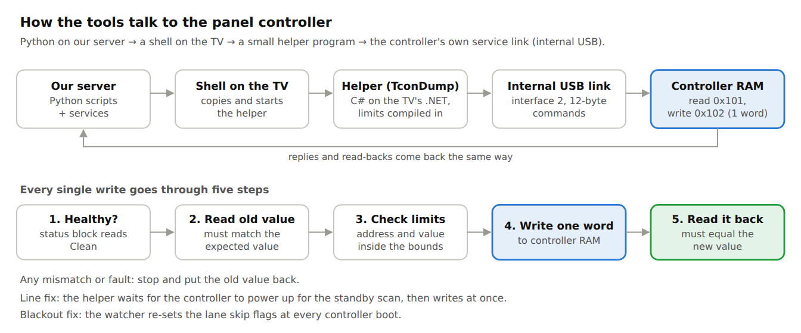

# How the tools work: talking to the panel controller

Both fixes come down to reading and changing a few values in the panel controller's working memory (RAM) at the right
moment. This page explains the tool chain that does it, from the server to the controller and back. The commands are in
the [guide](../../../tools/tcon-calibration/GUIDE.md); the wire-level details are in
[CONTROLLER-COMMUNICATIONS.md](../CONTROLLER-COMMUNICATIONS.md).

## 1. The controller's service link

Inside the TV the panel controller (TCON) hangs off the main board on an **internal USB connection** (`04e8:2001`). Besides
carrying its normal traffic, it offers a simple service interface: **interface 2, with one bulk endpoint each way**
(`0x02` out, `0x82` in). Each request is a **12-byte header** (operation, address, length), followed by data for a
write:

| Operation | What it does | Used for |
| --- | --- | --- |
| `0x101` | Read controller RAM or registers | Status checks, gain tables, stored-result reads, the live compensation planes |
| `0x1` | Read the controller's ID block | Confirming which controller and firmware we talk to |
| `0x103` | Read controller storage (flash) | The hash-checked backup and reading the stored scan result (read only) |
| `0x102` | Write one 32-bit word to RAM | The only write we use: gain words, runtime trims, lane skip flags |

The TV's Linux system can open this interface through the kernel's generic USB access (`usbfs`), as long as nothing
else holds it. That is the whole "debugger": no special hardware, no firmware change, just the controller's own
service commands sent from the TV itself.

The link is not perfect. Under long bulk write runs it lost about **1 write in 3,600**, so the tools write as little as
possible, one word at a time, and verify every write by reading it back.

## 2. The helper program on the TV

A small C# program, **TconDump**, runs on the TV with .NET (source: [tcon/helpers](../../../tools/tcon-calibration/tcon/helpers/)). It opens the USB device, claims interface 2, sends the
headers and reads the replies. It ships as source only, in three builds, and each one has its limits compiled in:

| Build | Job | What it may write |
| --- | --- | --- |
| `read-poke` | Bulk reads, single verified writes, restore | Gain words of lanes 600–660 only: each 16-bit half 8000–26000, at most 8000 change per write (the Python tools add a ×0.65-of-stock floor) |
| `scan-arm` | Waits for the TV's scan and sets the scan gain at the right moment | Same bounds as above |
| `runtime` | Runtime trims after each controller boot | Four runtime gain words and the colour weight pairs, at fixed addresses, within fixed limits |
| `lane-mask-read` / `lane-mask-write` / `lane-mask-firstscan` (separate programs, same approach) | The blackout fix: read the lane table, set the skip flags, and set them during the first scan after power-on | Only bit 0 of the 122 lane-table entries for lanes 540–661, only on a healthy controller |
| `tcon-power-cycle` (optional) | Recovery of an already-faulted controller | Nothing in controller memory: one fixed request to the TV's own driver for its normal controller off-then-on sequence |

Every write goes through the same five steps:

1. **Controller healthy?** Read the status block (`0x47012400`). Write only when it is *Clean*: stop 0, fault 0,
   gate 1, limit 40.
2. **Read the current value** and compare it with the expected old value. A mismatch stops the run.
3. **Check the bounds:** address and new value must be inside the limits compiled into that build.
4. **Write one word.**
5. **Read it back.** A mismatch triggers a restore of the old value.

The very first write on a new TV is an *identity write* (old value written back unchanged), which proves the path
without changing anything.

## 3. Hitting the right moment: the scan-time write

The line fix needs the gain set **during the TV's own standby scan**, a moment when the TV is "off" and the controller
only powers up for the scan. The `scan-arm` helper is started on the TV beforehand and waits:

1. It watches for the controller's USB device to appear (the controller powering up for the scan).
2. It waits until the gain table is loaded (every expected old value is present) and the controller is healthy.
3. It writes the new gain words, reads them back, then logs the controller's scan stage every 50 ms.
4. When the scan ends and the controller powers down, the run is over and the RAM value disappears with it. Only the
   TV's own save keeps the result.
5. If it is cancelled or anything fails before that point, it puts the old values back.

## 4. The scripts on the server

The server runs Python scripts that reach the TV through a shell on the TV (a prerequisite this repository does not
cover). They copy the helper over, run it, fetch the result and decide what to do next:

| Script | What it does |
| --- | --- |
| `tcon/backup_items.py` | Full read-only, hash-checked backup of controller storage before anything else |
| `tcon/tvdump.py`, `tcon/tvtool.py` | Read dumps; single verified writes and restores |
| `tcon/d4store.py`, `tcon/decode_c1.py` | Read the stored scan result and the live compensation, column by column |
| `tcon/bake_now.py`, `tcon/after_now.sh` | One on-demand calibration run, then compare the result with the prediction |
| `tcon/rt_tool.py` | Audit, apply or remove the runtime trims |
| `measure/` | Make test clips, play them on the media player, photograph with the camera and compute each column's brightness |
| `offline/s0words.py` | Turn gains into the exact words and refuse anything outside the limits (no TV contact) |

All tools take the same **lock on the TV**, so only one of them talks to the controller at a time, and they pause the
blackout watcher while they work, then resume it.

## 5. The services that keep it working

RAM clears whenever the controller powers down, so a few small services re-apply things automatically:

| Service | Keeps | How |
| --- | --- | --- |
| [Lane-mask watcher](../../../tools/tcon-calibration/services/lane-mask-watcher/README.md) | The blackout fix | Notices each controller boot, waits until it is healthy, sets the 122 lane skip flags and reads them back. If the controller has already faulted, it can (optionally) switch the TV to its Apps home and request one stock controller power cycle, within strict budgets ([background](../BLACKOUT-MITIGATION.md#watcher-recovery-and-source-coordination)) |
| `s0-nightly` | The line fix | Arms every qualifying standby scan with the calibration gains, then audits the stored result |
| `s95f-rt` | The runtime trims | Re-applies them within a minute or two of each controller boot |
| `bake11-guard` | The stored calibration | Checks it at every boot and twice a day; if it is gone, turns the trims off and repeats the calibration run in a quiet window |

## 6. What the tools never do

No writes to controller flash, stored compensation or calibration storage, no firmware changes, and no writes outside
the compiled-in limits. The TV's own scan and save do the persistent part.
See [GUIDE §15](../../../tools/tcon-calibration/GUIDE.md#15-what-not-to-write) for the full list.
