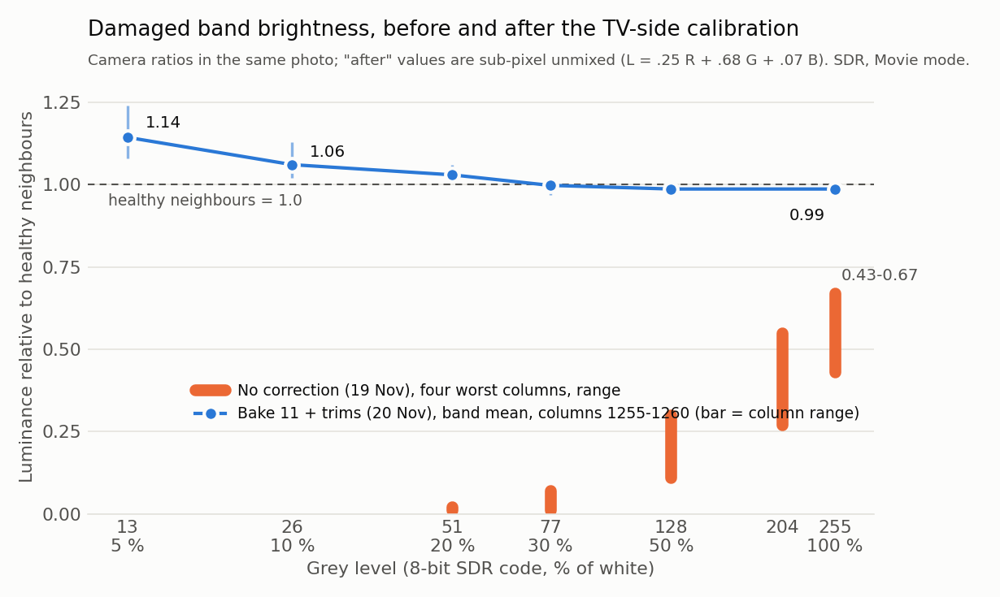
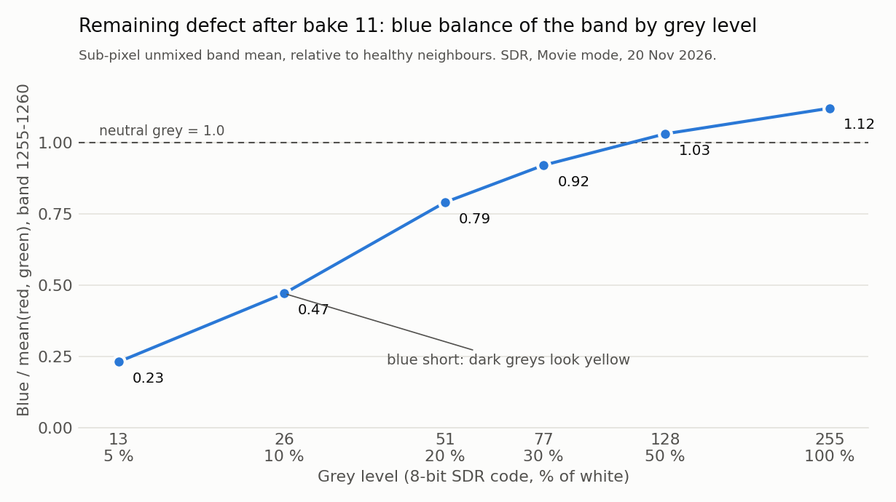
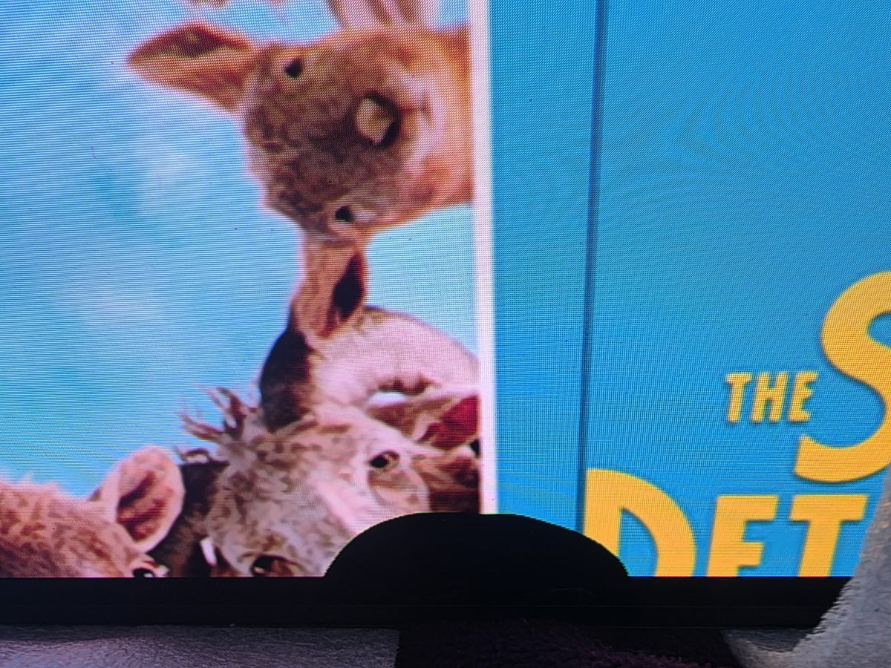
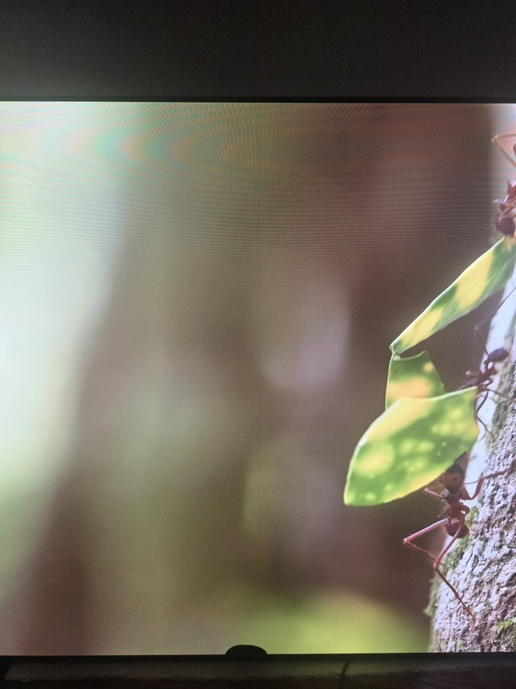
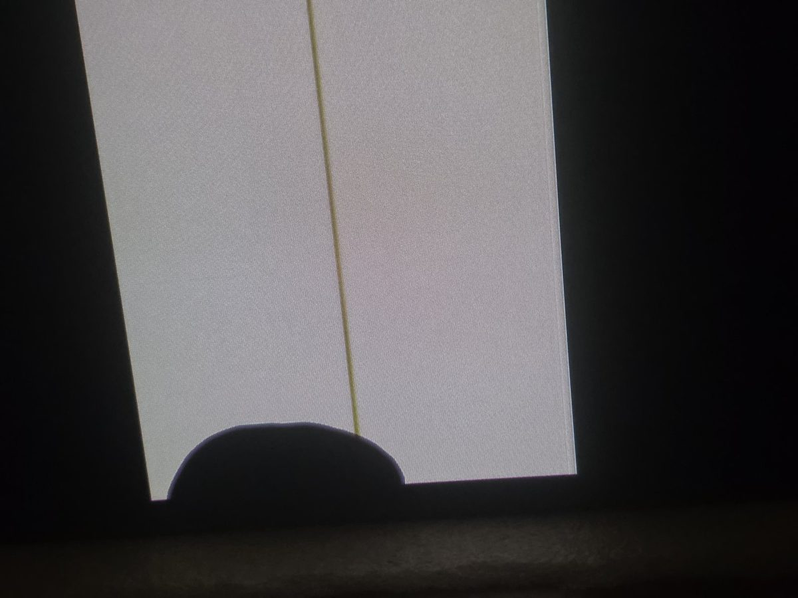
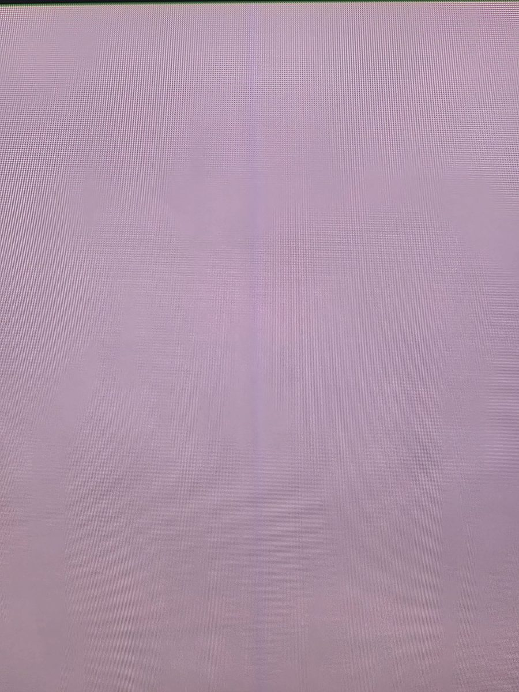
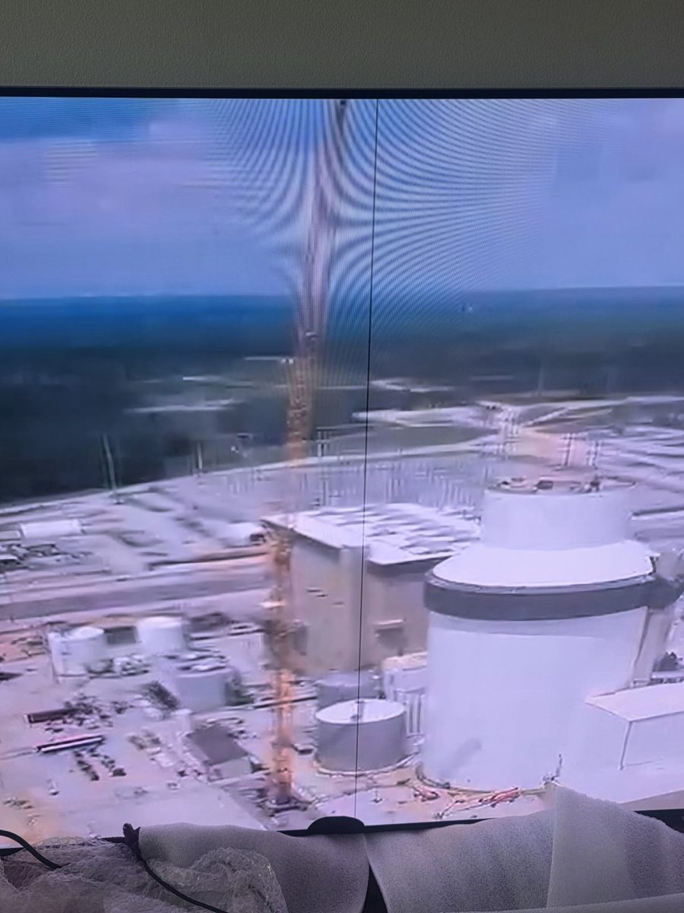
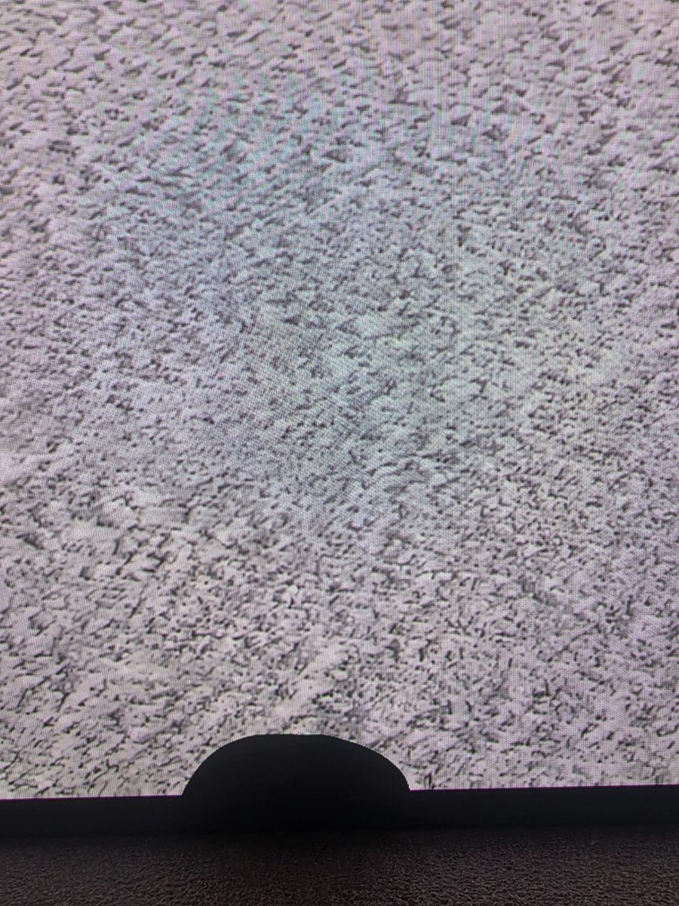
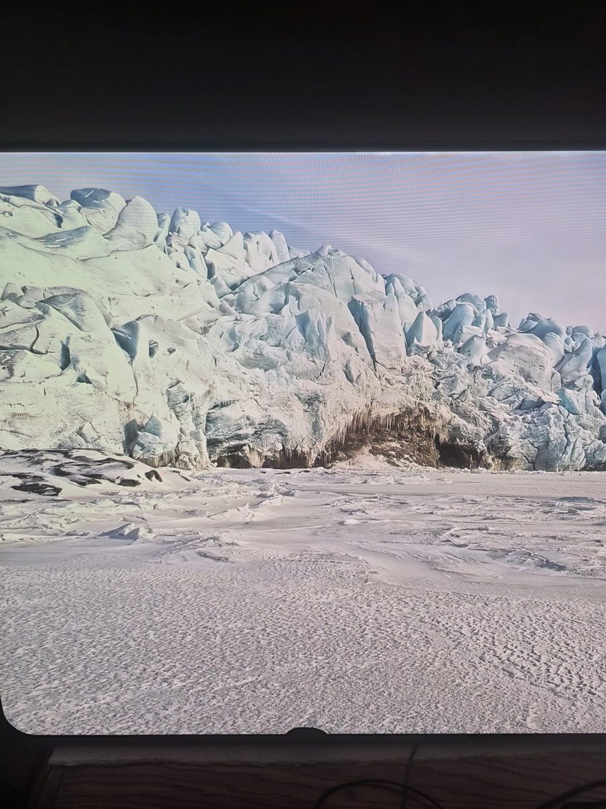
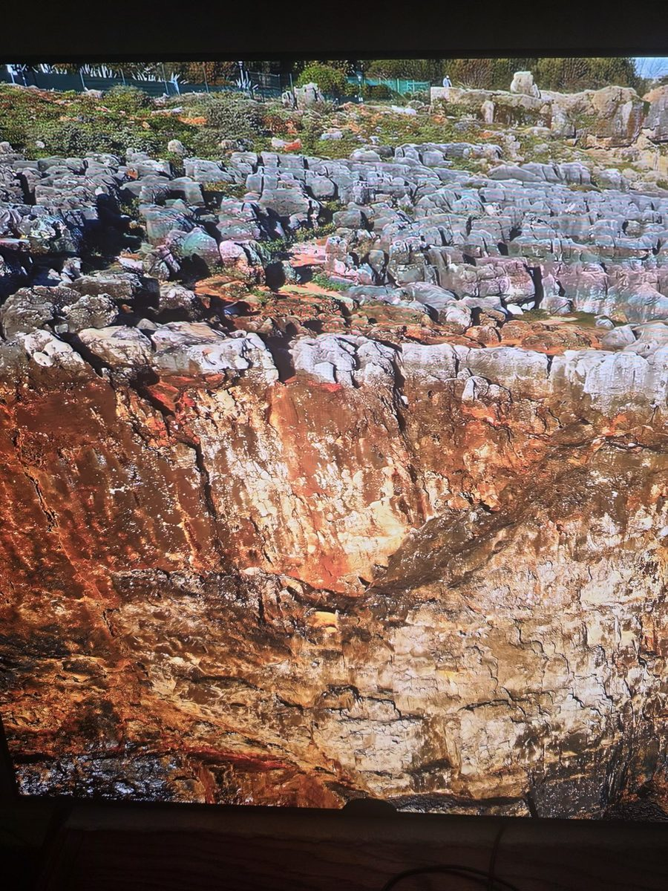

# Calibrating damaged QD-OLED columns through the TV's own compensation scan

**Samsung S95F, 77-inch QD-OLED · status: final setting, acceptance scan pending**

This is the story of how a physically damaged band of columns on one S95F panel was brought back to within a few
percent of its neighbours, **inside the TV**, for every source and app, without writing the panel's calibration storage
ourselves. It is written for other owners of damaged panels and for engineers who want to build on it. Numbers are in
[RESULTS.md](RESULTS.md); the earlier, player-side correction and the blackout mask are described elsewhere in this
repository.

## In short

- Columns 1255–1260 of the panel are damaged. Uncorrected, the four worst gave about **1 % of normal light at 20 % grey**
  and 11–30 % at 50 % grey.
- The TV already measures every sub-pixel in a maintenance scan and compensates drive from the result. The damaged
  columns measured wrongly, so the TV gave them **no** extra drive at all.
- We changed how the scan *sees* those columns (a sensing gain in controller RAM, set just before each scan). The TV's
  own scan then stores a compensation that drives them properly, and the TV's own save path keeps it.
- Two small RAM-only runtime settings on top, and a server-side service set that re-applies everything after power
  cuts, scans and reboots.
- Result: band brightness within **1–2 % from 30 % grey to white**, about +3 % at 20 % and +6 % at 10 % grey. Red and
  green within about 3 % from 30 % grey up (green +5 % at 20 % grey). **Remaining defect:** blue is short in dark greys, so the band looks slightly
  yellow there.
- This required root on the TV and access to the panel controller's RAM. This write-up does not cover how that access
  is obtained.

## 1. The damage

The panel has impact damage at its bottom edge with a vertical line of damaged columns above it. At first the
damaged columns lacked about 14–23 8-bit codes of drive and a player-side correction (a per-column video layer) could
hide them. A few weeks later the shortfall was **65–75 codes for red and green, more for blue**, and the four worst
columns were practically black up to 30 % grey (RESULTS §2). The damage was growing; a video-layer correction of that
size is no longer practical, and it never covered the TV's own apps or other inputs.

The same panel also had a separate fault: the screen went black while sound continued. That is handled by a lane mask
on the panel controller's sensing-consistency check, described in [BLACKOUT-MITIGATION.md](../BLACKOUT-MITIGATION.md).
It stays in place underneath everything here.

## 2. Measuring it: camera sub-pixel unmixing against healthy neighbours

Every decision rests on photos, so the method matters more than any single number.

- **Stimulus.** A media player shows a narrow bar (320 columns wide) of exact grey or a single primary on a black
  screen, centred on the damaged band. No bright full-screen patterns, nothing static for longer than needed, and the
  player is blanked between shots. Levels: grey 13, 26, 51, 77, 128, 255 (5–100 %) plus single primaries.
- **Camera.** A full-frame camera in RAW on a tripod, close enough that one panel column spans about 13 camera pixels.
- **Ratios, not absolutes.** Each damaged column is divided by the healthy columns next to the band *in the same
  photo*. Exposure, room light and panel temperature cancel out. 1.00 means "same as the neighbours".
- **Registration.** The column grid is re-fitted in every photo (period and offset), because a camera that moves by a
  fraction of a column silently shifts every label. This bit us once and is now automatic.
- **Sub-pixel unmixing.** The camera's colour channels overlap: on this panel its green channel sees about 20 % blue
  light, and its blue channel sees some green. Measured with single-primary bars, the overlap is a 3×3 matrix; inverting
  it turns camera R/G/B into panel sub-pixel R/G/B. Without this, missing blue hides inside the camera's green and the
  colour balance looks better than it is. Luminance is then L = .25 R + .68 G + .07 B.
- **Guards.** Before each shot the tools check that the TV is showing the player's video (no TV menu, no screensaver),
  that the player shows full-screen video with no pop-up, that the healthy field matches a reference set within 1–2 %,
  and that the exposure is plausible. Sets that fail a guard are thrown away, not interpreted.

## 3. Why the TV's own compensation did not help

OLED sub-pixels age and differ, so the TV compensates them. While the TV is in standby it periodically runs a
**power-off sensing scan**: it measures each sub-pixel's electrical characteristic, stores the result per column and
colour, and uses it at every power-on to add drive where a sub-pixel needs it. The same scan can be started from the
menu (**Screen Optimization**, "Start Now"); the TV then turns itself off and back on, about 12 minutes in all.

Reading the stored scan result next to the camera photos showed three things:

1. The damaged columns read **very high** (hundreds of counts above healthy), and the shortfall of light was
   proportional to that excess.
2. The compensation *is* applied on healthy columns (their small reading differences match nothing in the light, i.e.
   they are corrected).
3. The hardware only ever **adds** drive, and only for readings below a neutral point. Healthy columns read about
   100–120 counts below neutral and get their normal share. The damaged columns read far above it and got nothing.

So the TV's own repair mechanism was switched off for exactly the columns that needed it, by their own faulty readings.

## 4. The idea: calibrate through the panel's compensation scan

We do not write the panel's stored compensation, demura data or flash: that was a hard limit from the start, because
a bad write there could brick the panel. Instead:

- The scan reads each **sense channel** through a gain that sits in the controller's RAM. One sense channel ("lane")
  covers two panel columns, and the gain has one half per column, so it can be set per column. It is common to red,
  green and blue.
- If that gain is lowered on the damaged lanes **just before the scan starts**, the scan sees those columns as reading
  lower, stores a result below neutral, and from then on the compensation adds drive to them at every power-on.
- The stored result is written to the controller's flash by the **TV's own save**, in its own format, exactly as it is
  every night. Our change is a few RAM words that the controller clears whenever it powers down.
- Rollback is simple: any scan that runs without our gain change stores the stock result again.

The first attempt (lane 629 at ×0.85) moved the stored reading but left it above neutral, and nothing changed on
screen. That looked like failure until the "adds drive only below neutral" rule was understood. The second attempt
(×0.80 on both worst lanes) closed about **75 % of the red/green gap and 60 % of the blue gap** in one scan
(RESULTS §3–4). From there it was careful stepping: bake 5 went too far and two columns glowed near black (overshoot is
strongly non-linear near neutral), bake 6 went back and showed the scan repeats to about one count, and bakes 7–11
shaped the result column by column.

**The firmware's own line repair.** One more stock mechanism shapes everything: after the scan, the firmware repairs
isolated vertical lines in the stored result. A column that differs from both neighbours by more than about 40–45
counts is replaced by the mean of the three largest of its four nearest neighbours. On a band of damaged columns this
means each column partly inherits a damaged neighbour's reading. Understanding this (bake 8) explained puzzling
"cross-talk" between lanes and fixed two columns that had stayed dim near black.

## 5. The three TV-side layers

| Layer | What | Lives in | Survives |
|---|---|---|---|
| 1. Scan-time sensing gain ("the bake") | Per-column gain on lanes 627–630, set just before each scan | Result in TV flash (stored by the TV) | Power cuts; replaced at the next scan unless set again |
| 2. Runtime sensing gain | Per-lane gain used by the panel's real-time correction loop (runs about every 24 s while on): ×0.90 / ×0.67 / ×0.60 / ×0.78 on lanes 627–630 | Controller RAM | Until the next controller boot |
| 3. Blue runtime weight | Panel-wide strength of the blue compensation, ×4 of stock | Controller RAM | Until the next controller boot |

Why three: the bake alone (layer 1) left bright scenes 6–9 % short, because one gain per column cannot fit every level.
The runtime gain (layer 2) acts like a brightness gain on the band: about +5–6 % light per −25 % gain, equal in red,
green and blue. The blue weight (layer 3) scales the blue compensation; healthy columns carry little compensation, so
it acts mainly on the band. It is not free: the healthy panel's blue drops about 1 % per +100 units, so the white is a
little warmer (the TV's white-balance blue gain can offset that). Bake 11 then re-tuned layer 1 so the band was no
longer over-driven in red/green at low grey (camera maximum at 10 % grey: 1.20 before, 1.01 after; RESULTS §6).

## 6. Keeping it on the TV

Layer 1 has to be re-applied before **every** scan, and layers 2–3 after **every** controller boot. Three small services
on an always-on server do that:

- **Night service:** waits for a standby in which the TV will scan (the TV scans about 15 minutes into the first standby
  that starts at least about 4 hours after its last scan), sets the bake gains right after the controller powers up for
  the scan, and afterwards checks the stored result against the last good one. A bad result latches it off.
- **Runtime service:** sees each new controller boot and re-applies layers 2–3 within a few minutes; the guard switches them off
  about 10 minutes after boot if the stored result is not the bake those trims were fitted for.
- **Guard:** reads the stored result at each boot and twice a day. If the bake is gone (a scan without us, a menu scan,
  a server outage), it switches the runtime trims off at once, then re-runs the bake by itself when nobody is watching,
  inside a daytime/evening window, at most twice a day, and stops and reports after two failures.

Not covered: a TV **firmware update** (it would remove the access this depends on, the blackout mask and the bake; keep
automatic updates off), a factory reset, and loss of the server.

## 7. Results

| Grey | 100 % | 50 % | 30 % | 20 % | 10 % | 5 % |
|---|---|---|---|---|---|---|
| Uncorrected, four worst columns | 0.43–0.67 | 0.11–0.30 | 0.01–0.07 | ~0.01 | black | black |
| Final luminance, band mean (sub-pixel) | 0.99 | 0.99 | 1.00 | 1.03 | 1.06 | 1.14 |
| Final luminance, column range | 0.98–1.00 | 0.97–1.00 | 0.97–1.02 | 1.01–1.06 | 1.02–1.13 | 1.08–1.24 |
| Final blue ÷ mean(red, green), band mean | 1.12 | 1.03 | 0.92 | 0.79 | 0.47 | 0.23 |

The owner judged the final state by eye on real content, dark and bright scenes, and approved it. Note that the
"+6 % at 10 % grey" is photopic luminance; at about 1 cd/m² a dark-adapted eye weights blue more, and the same photo
then reads about 1.00 (an illustration from the same photo, not a separate measurement). In the room, the band in
dark scenes reads as slightly yellow, not as too bright.

All measurements are SDR in Movie mode, along one horizontal strip of the panel. Full tables, the progression through
eleven bakes and the reliability figures: [RESULTS.md](RESULTS.md).

## 8. What failed, and why

| Approach | What happened |
|---|---|
| Runtime gain on the damaged columns before any bake | No response: the columns read above neutral, so no gain change could add drive. It became useful only after the bakes (layer 2). |
| Switching compensation enable and gate registers off for 30–50 s | No visible change anywhere. Dropped. |
| Bake 1 (too small) | Stored reading moved, light did not. Taught us the "below neutral only" rule. |
| Bake 5 (too large) | Two columns glowed, 11–29× too bright near black. Rolled back next scan. |
| One gain per column for all colours | Cannot fix blue at low grey: the damaged columns' blue reads 125–155 counts above their red, and the line repair mixes in damaged neighbours. The stored blue sits on a floor no gain set can go below (RESULTS §7). |
| Panel curve tables | They act on the whole panel, not on columns; the band's blue moved by 0.03 where 0.5 was needed. One test write made the controller report a fault and restart itself (no lasting effect). Closed. |
| Editing the blue part of the scan's raw measurement during the scan | It worked where it was applied: stored blue equal to red on the band, correct blue on photos at every level. But bulk writes over the controller's debug channel proved unreliable, so that method was dropped. A good result would also have lasted only until the next nightly scan. |
| Red/green runtime weights to flatten the low-grey excess | Gain-like, nearly the same at every level; they trade bright against dark greys. A small combined re-tune exists (about 3 points at 10 % grey) but was not needed. |
| Player-side (video-layer) correction | Worked for content from the media player only. Retired on this TV in favour of the TV-side calibration. |

## 9. Safety rules we followed

The owner's limit was "don't brick the TV". In practice:

- **Never** write the panel's stored compensation, demura data, controller flash, the TV's eMMC, boot areas or
  factory data. The stored result only ever changes through the TV's own scan and save.
- A full read-only backup of the controller's storage, hash-checked, before the first write of any kind.
- Reads before writes. The first write ever was an identity write (the existing value written back, read back, compared).
- RAM changes only, each verified by read-back, each with a restore path that does not depend on the current value;
  the controller clears them at every power-down anyway. The calibration in daily use needs only a few words per scan
  and per boot. Bulk writes during the scan were abandoned (section 8).
- Hard bounds on every gain the tools will set, small steps per scan, and a stop on any controller fault state.
- Every tool was independently reviewed before routine use, and again after each change. Once, an unreviewed
  curve-table command ran live by mistake (restored and verified within a minute), which produced the rule below. Analysis consults ran offline on saved data.
- As few variables per test as possible. Every bake was predicted first and checked against its prediction before the next one.
- The panel's own protections stay on, except the narrow blackout mask, which is re-verified at every boot.
- Lessons that became rules: never run a live-capable command "to test argument parsing"; never write the curve table
  that faulted; never leave a static test picture on the OLED.
- **Dark restarts.** Twice, the TV came back from an on-demand scan with the screen dark (most likely the TV's own fault
  monitor had switched the panel controller off at boot). A normal restart fixed it both times; the cause is unknown. All 14
  on-demand scans whose restart fell between late morning and about 01:45 TV local came back normally, the two that
  restarted after 02:00 did not. On-demand scans now start only between 10:30 and 01:15 TV local, only on a boot that
  looks healthy, with exactly one restart as the remedy and a stop-and-notify after that. Natural standby scans do not
  restart the TV and are not affected. Owner remedy if the screen is ever dark after power-on: unplug the TV for 10 s.

## 10. What is left

- **Dark-grey yellow tint.** Blue on the band is 0.79 of red/green at 20 % grey, 0.47 at 10 % and 0.23 at 5 %. No
  TV-side setting can add it. The one remaining fix is a small per-column blue lift in the media player's video path
  (about +3 to +10 8-bit codes of blue at 5–30 % grey on top of this calibration, slightly less blue at white), for
  player content only, and on this player only for 10-bit content such as HDR10, not 8-bit SDR. Deferred by the owner.
- **Drift.** The damaged columns' own readings drifted 0.6–0.9 % over a few days, which with fixed gains moves the
  band by about ±5–7 % at 10 % grey. A nightly step that re-fits the gains from each scan, inside tight bounds, is
  designed but not built; the next scans decide whether it is needed.
- **Never measured:** the band along the panel's height (one strip was photographed), HDR, game mode and VRR.
- **Open:** why two on-demand restarts came back dark; whether the first ordinary night under the final automation
  behaves as built (it is the acceptance test).
- The damage itself is still there and may keep growing; the calibration follows the panel's own measurement, so
  slow change is partly absorbed, but large change would need a new bake series.

## 11. Notes for other owners and engineers

- Measure first, with ratios to healthy neighbours in the same photo and with sub-pixel unmixing. Camera green is not
  panel green.
- Expect **no response at all** until the damaged columns' stored reading is pushed below neutral. A null result from a
  small step does not close the route.
- Step small near neutral and look at near-black every time: overshoot shows up as glow at 2–5 % grey long before it
  shows at mid grey.
- The firmware's vertical-line repair couples neighbouring columns. Model it, or your per-lane results will not make
  sense.
- A per-column gain is common to all three colours. If the damaged sub-pixels' colour readings differ a lot, one colour
  will be left with a floor.
- Anything you set in RAM must be set again for every scan and after every controller boot, or it is gone. Plan the
  automation and the "lost bake" path before you rely on it.
- Keep firmware auto-update off on a modified TV.

## 12. Will this work on other OLED and QD-OLED TVs?

The idea carries over; our numbers do not. Nothing here has been tried on another TV.

| TV | What is similar | What is unknown |
|---|---|---|
| Other Samsung QD-OLED TVs (other years, sizes) | Same panel maker; likely the same standby sensing and compensation | Controller firmware, addresses and internal link may differ; each TV must be mapped again |
| Other brands using Samsung Display QD-OLED panels, and QD-OLED monitors | Same panel technology | Different main boards and controller firmware; unknown whether a sensing gain is exposed |
| LG Display WOLED TVs (several brands) | Also measure the panel in standby and compensate from it | Different controller, firmware and OS; nothing mapped |

The method can work only when all four hold: the TV compensates from its own measurement; the damaged columns read
wrong in the direction the compensation ignores; you can change the measurement in controller RAM at scan time on your
own TV; and you can measure each column with a camera. It cannot help electrically dead columns, damage that already
reads correctly with the compensation at its limit, or a controller you cannot reach. The blackout mask applies only if
the blackout comes from a per-lane sensing-consistency check like this one. A per-column correction in the media player
works on any display, but only for that player's content.

## 13. Photos and tools

Before and after bake 11, phone photos, EXIF removed:

| Before | After |
| :---: | :---: |
|  |  |
|  |  |
|  |  |
| |  |
| |  |

On flat pale fields a faint trace is still visible. Rainbow rings in some photos are camera moiré, not the panel.

The scripts, constants and a step-by-step guide are in [tools/tcon-calibration](../../../tools/tcon-calibration/GUIDE.md).
They need a root shell on your own TV; the guide does not cover how to get one.

*Independent owner-device research. Not affiliated with Samsung. Writing to a TV's panel controller can damage it; follow
the safety rules in section 9 and in the guide, and only work on a TV you own.*
